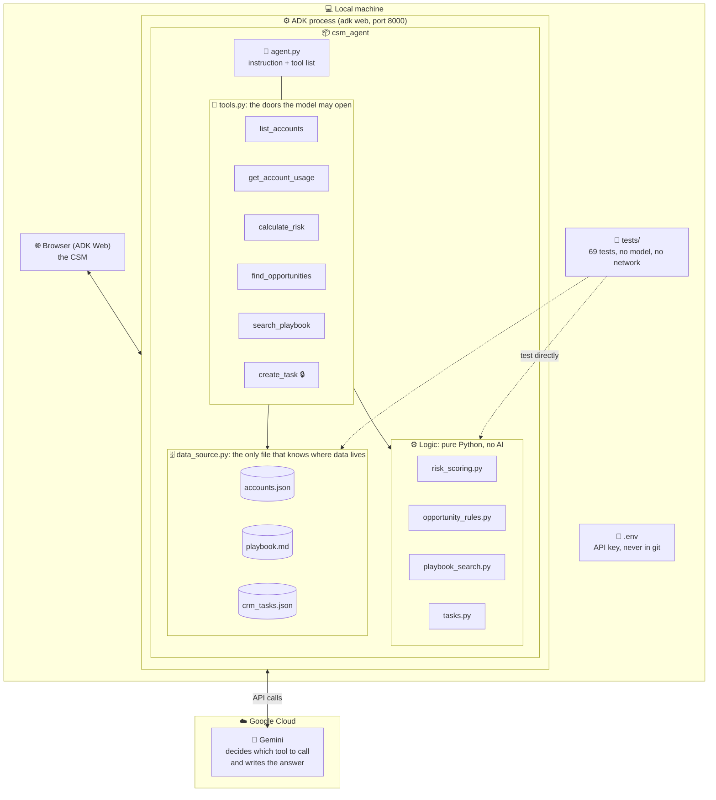
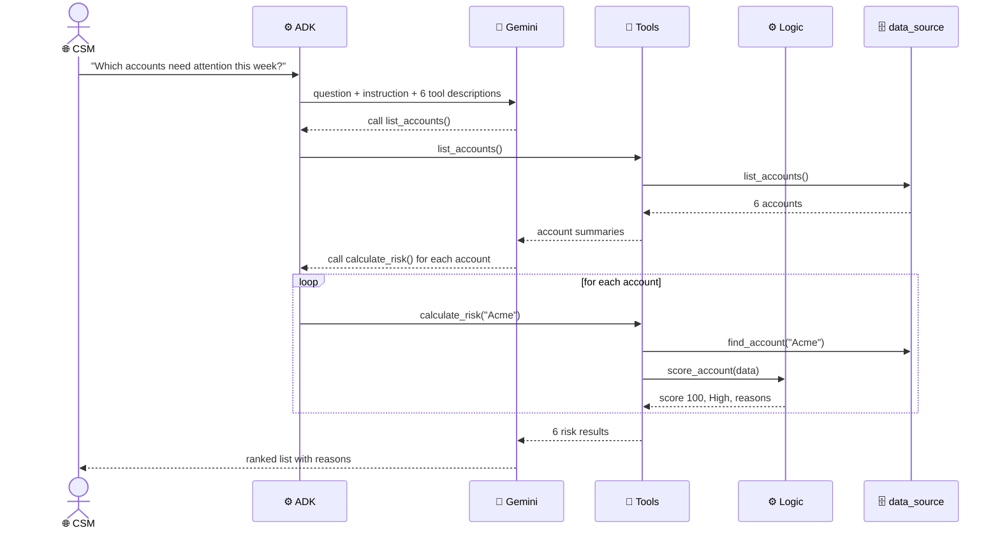
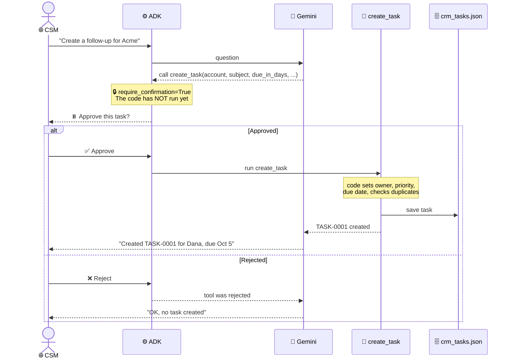

# Architecture

> Learning project. All data is fictional. See the [README](../README.md).

## 1. The system map

Where everything lives. Gemini is the only part outside your machine, and the only part that "thinks". It never touches data directly. It can only ask to call a tool.

## 2. The layers and why each exists

| Layer | File(s) | Responsibility | Without it... |
|---|---|---|---|
| 🧠 **Model** | Gemini (cloud) | Understands the question, decides which tools to call, explains results | You'd need an `if` for every possible CSM question |
| 🤖 **Agent** | `agent.py` | Instruction (system prompt) + list of allowed tools | The model wouldn't know its role or its rules |
| 🧰 **Tools** | `tools.py` | The only actions the model can take. Docstrings are the model's "manual" | The model would invent data it has no access to |
| ⚙️ **Logic** | `risk_scoring.py`, `opportunity_rules.py`, `playbook_search.py`, `tasks.py` | Deterministic calculations: same input, same output | The score would change between runs and couldn't be explained or tested |
| 🗄️ **Data access** | `data_source.py` | Reads and writes accounts, playbook, tasks | Moving to Salesforce would mean changing every file |
| 🔒 **Approval** | `FunctionTool(..., require_confirmation=True)` | Framework pauses before the CRM write | The model could write to the CRM on its own, even when wrong |

**One sentence:** the model decides *what* to do, tools define *what is possible*, logic calculates *the answer*, and the data layer knows *where data lives*. Each layer can be replaced without touching the others.

## 3. How a request flows

### Portfolio question: "Which accounts need attention this week?"

The model chooses the sequence on its own. No code says "first list, then score".

### Writing to the CRM: human in the loop

## 4. Who decides what

The model is responsible only for language and judgment. Everything that must be consistent or exact is decided in code.

| Decision | Model 🧠 | Code ⚙️ |
|---|---|---|
| Which tools to call, in what order | ✅ | |
| Risk score, level, reasons | | ✅ |
| Urgency (days to renewal) | | ✅ |
| Which opportunities exist | | ✅ |
| Which playbook section matches | | ✅ |
| Task subject and description (wording) | ✅ | |
| Task due date (from `due_in_days`) | | ✅ (models get date math wrong) |
| Task priority | | ✅ (from risk level) |
| Task owner | | ✅ (account's CSM) |
| Whether a task is a duplicate | | ✅ |
| Whether the task is created at all | | 👤 **The human** |

## 5. Moving to production

Only `data_source.py` changes. Every other file stays the same.

| Today (mock) | Production example |
|---|---|
| `accounts.json` | Salesforce (accounts, contracts) + product telemetry (downloads, consumption) + support system (tickets) |
| `playbook.md` | Confluence / Notion / Gainsight. For a large playbook, a RAG search such as Vertex AI Search |
| `crm_tasks.json` | Salesforce Task object |
| `adk web` locally | Deployed agent, e.g. Cloud Run or Vertex AI Agent Engine |
| Free-tier API key | Paid key with quota and monitoring |
